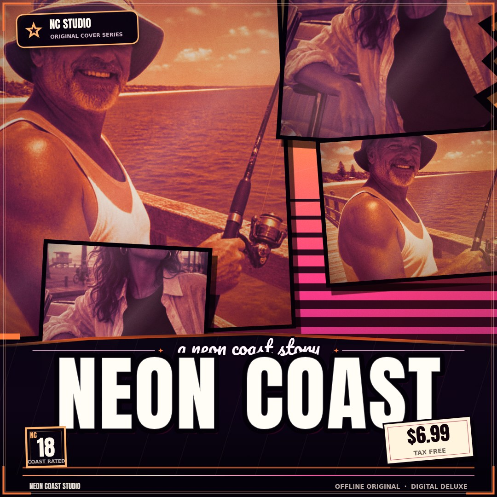

# Neon Coast Studio · GTA 6 style cover art maker

[](https://make.fun/bounty/gta6-cover-art-01)
[](https://make.fun/bounty/gta6-cover-art-01/leaderboard)
[](https://make.fun/bounty/gta6-cover-art-01)

Neon Coast Studio turns your own photographs and a caption into poster-style cover art with the neon-sunset mood of a modern open-world game box. It renders a multi-panel collage on an HTML canvas, adds a title and script subtitle, and exports the result as a PNG. The whole application is static files: it runs entirely offline in the browser, makes no uploads, and never sends your photos anywhere.



## What it does

Add a few photos, type a title and an optional neon-script subtitle, then arrange the shots across a set of tilted and torn panels. The renderer colour-grades each panel, builds a sunset backdrop, and draws the title plate, rating badge, price sticker and footer strip over the composition. When the preview looks right, export a PNG at the chosen post size. There is no account, no server-side processing and no network request after the page and its local assets have loaded.

## Run it locally

The repository includes a small standard-library static server for the `app/` folder:

```sh
node serve.ts
```

Then open <http://localhost:8080>. Node 22 or newer is recommended.

You can also skip `serve.ts` and point any static file server at `app/`; there is no build step and no package install. The browser needs to load `app/index.html` and its ES modules from the same origin.

To rebuild the submission output instead, run:

```sh
mkdir -p out && MAKEFUN_OUTPUT_DIR=out node main.ts
```

That copies `app/` and `screenshots/` into `out/` and writes `out/dossier.json`. Inside the bounty's container the default output directory is `/output`.

## Post sizes

| Preset   | Dimensions | Shape          |
| -------- | ---------- | -------------- |
| Square   | 1080 × 1080 | Square post    |
| Portrait | 1080 × 1350 | Portrait post  |
| Wide     | 1920 × 1080 | Landscape post |

The size buttons in the sidebar switch the canvas and the exported PNG to one of these three formats. The export is always a PNG named from the active size, for example `neon-coast-1080x1350.png`.

## The editor

The left sidebar holds the controls, while the large preview in the workspace updates live.

- **Photos.** Use **Add photos** to pick one or more local image files. On the first batch the photos fill the available panels; later batches are placed starting at the selected panel. The thumbnails in the photo list can be clicked to place a specific photo on the selected panel, and **Use on all panels** repeats the current photo across every panel. Two bundled demo photos are also available so the app can open with a finished-looking cover.
- **Selecting and framing.** Click any panel in the preview to select it. The selected panel is outlined in the editor, and the **Selected panel** heading shows its position, for example `02 / 04`. Drag inside a panel to reposition the photo, and use the mouse wheel or the **Zoom** slider to zoom between 100% and 350%. **Centre** resets the pan, while **Reset crop** restores the default zoom and position.
- **Grades.** Each panel has its own grade preset: **Hot Amber**, **Cool Indigo**, **Gold Violet** or **Cyan Neon**. The **Grade strength** slider controls how strongly the colour grade is applied, from 0% to 100%.
- **Layout.** Choose **Collage**, **Hero Cut**, **Split Cut**, **Tilted Snaps**, **Nine Mosaic** or **Full Bleed**. The first four are four-panel arrangements, Nine Mosaic uses nine panels, and Full Bleed uses a single full-frame photo with the title overlaid.
- **Text.** The **Title** field sets the large Anton lettering; the **Neon script** field sets the smaller Pacifico subtitle above it.
- **History.** **Undo** and **Redo** step through edits. When focus is not in a text field, `Ctrl/Cmd+Z` undoes, `Ctrl/Cmd+Shift+Z` redoes, and `Ctrl/Cmd+Y` also redoes.
- **Export.** **Export PNG** renders without the editor selection outline, downloads the PNG, and reports the saved filename in the status line.

The status line also confirms that photos stay on the machine. Uploaded files are turned into local object URLs and drawn directly into the canvas; nothing is posted to a server.

## Screenshot scenes

The app has two deterministic capture scenes, selected with the `shot` query parameter. Both wait for the bundled fonts and images, paint two animation frames, then set `window.__shotReady = true` and `document.documentElement.dataset.shotReady = "true"` so an automated capture tool knows the scene is ready.

- `?shot=cover` renders the cover without the editor selection outline.
- `?shot=editor` renders the editor with the current panel outlined and the editing chrome visible.

Both scenes accept the same optional query parameters:

| Parameter  | Meaning |
| ---------- | ------- |
| `photo`    | `boulevard` or `pier`; chooses which demo photo leads the panel fill (defaults to `pier`). |
| `caption`  | Title text (defaults to `Neon Coast`). |
| `subtitle` | Script subtitle (defaults to `a neon coast story`). |
| `size`     | `WIDTHxHEIGHT`, for example `1920x1080`; custom sizes are accepted from 320 to 4096 pixels per side. |
| `layout`   | `quad`, `hero`, `split`, `tilt`, `nine` or `single`. |
| `strength` | Grade strength from 0 to 100. |

Examples used by the capture list:

```text
?shot=cover&photo=pier&caption=Neon%20Coast&size=1080x1080
?shot=editor&photo=boulevard&caption=Miami%20Vice
?shot=cover&photo=boulevard&caption=Vice%20Nights&size=1920x1080
?shot=cover&photo=pier&caption=Coast%20Edition&size=1080x1350
```

`shots.json` records the four screenshot names, queries and capture dimensions used for this entry.

## File layout

```text
.
├── app/
│   ├── index.html          page shell and editor markup
│   ├── style.css           dark studio interface and responsive layout
│   ├── src/
│   │   ├── main.js         editor state, controls, history and export
│   │   ├── engine.js       canvas layouts, grading, title and cover rendering
│   │   └── photos.js       local file loading and demo photo URLs
│   ├── fonts/
│   │   ├── Anton-Regular.ttf
│   │   ├── Anton-OFL.txt
│   │   ├── Pacifico-Regular.ttf
│   │   └── Pacifico-OFL.txt
│   └── samples/
│       ├── boulevard.jpg
│       └── pier.jpg
├── screenshots/            captured cover and editor scenes
├── main.ts                 packaging script and dossier writer
├── serve.ts                local static server for app/
├── shots.json              automated capture list
├── vendor/makefun-app.ts   vendored make.fun dossier helper
├── .makefun/owner.json     bounty owner wallet
├── LICENSE
└── README.md
```

`out/` is generated by `main.ts` and is not part of the source layout.

## Original work and fonts

This is original work created for the bounty. It contains no Rockstar Games logo, artwork or fonts, and it does not reproduce any game's box art. The visual language is an original neon-coast cover style built from canvas gradients, generated grain and procedural panel shapes.

The two typefaces used by the renderer are **Anton** and **Pacifico**, both released under the SIL Open Font License. They are vendored locally in `app/fonts/` together with their licence texts, `Anton-OFL.txt` and `Pacifico-OFL.txt`, so the app remains offline and the font licensing travels with the repository. The demo photos in `app/samples/` were made for make.fun with an image model and are free to use with this entry.

## How it was built

The entry was built by an AI coding agent for make.fun's "Make GTA 6 Cover Art" bounty. The editor is hand-written vanilla JavaScript around the Canvas 2D API, with no browser framework and no build step. The cover renderer composes rotated panels through clipped offscreen canvases, applies a per-panel colour lookup grade and texture pass, and then draws the title plate, badges and frame. A small Node standard-library static server handles local development, while `main.ts` packages the static app and produces the judge's dossier. Dedicated `?shot=cover` and `?shot=editor` scenes were added so screenshots are reproducible without manual interaction.
